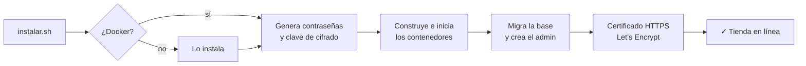
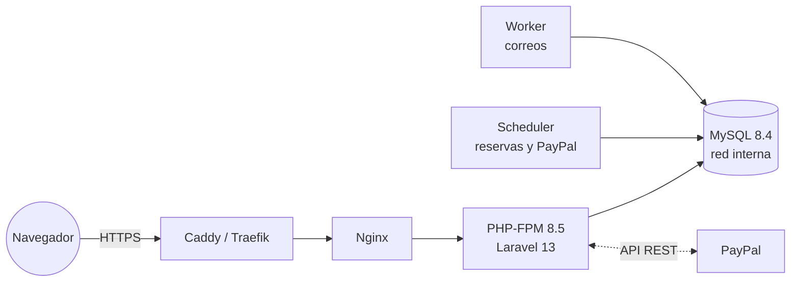

<div align="center">

# 🎭 Teatro

### Venta de entradas en línea con selección de asientos

Los compradores eligen la obra, la función y sus asientos en el plano de la sala, y pagan con PayPal.<br>
El teatro gestiona todo desde un panel de administración. Se instala con **un solo comando**.

[](https://laravel.com)
[](https://www.php.net)
[](https://www.mysql.com)
[](https://docs.docker.com/compose/)
[](https://developer.paypal.com)
[](#-pruebas-del-sistema)

**[Ver demostración en vivo](https://teatro.quepapayazo.com)** · [Guía de instalación](docs/GUIA-INSTALACION.md) · [Guía del administrador](docs/GUIA-ADMINISTRADOR.md) · [Guía del comprador](docs/GUIA-COMPRADOR.md)

</div>

---

## ✨ Funciones

<table>
<tr>
<td width="50%" valign="top">

### 🎟️ Para el comprador

- Cartelera con las obras que tienen funciones y asientos libres
- **Plano interactivo** de la sala, hasta 8 asientos por compra
- Asientos **retenidos 10 minutos** mientras paga
- Pago con **PayPal** o tarjeta
- Entradas con **número y código QR**, enviadas por correo
- Recuperación de entradas con correo y documento

</td>
<td width="50%" valign="top">

### 🛠️ Para el administrador

- Obras con portada, salas con **editor del plano**, funciones
- Control de **choques de horario** en cada sala
- Ventas: búsqueda, **reembolsos** con PayPal y exportación a CSV
- **PayPal y correo SMTP configurables desde el panel**
- Interruptor **Demostración ↔ PayPal** (Sandbox o Live)
- Varios administradores y **registro de auditoría**

</td>
</tr>
</table>

> 💡 **Funciona sin configurar nada.** Mientras PayPal no esté activado, la tienda trabaja en *modo demostración*: el flujo de compra es completo y el pago se simula.

---

## 🚀 Instalación

### Requisitos

| | |
|---|---|
| 🐧 **Servidor** | Linux (Ubuntu 22.04+, Debian 12…), 1 GB de RAM, acceso `sudo` |
| 🌐 **Dominio** | Un registro DNS **A** que apunte a la IP del servidor |
| 🐳 **Docker** | No hace falta instalarlo antes: el instalador lo hace si falta |

### En tres comandos

```bash
git clone https://github.com/devsfernandol/teatro-laravel.git teatro
cd teatro
sudo ./instalar.sh --dominio teatro.miempresa.com
```

Al terminar verá algo así:

```text
✓ Teatro está funcionando

  Tienda:                  https://teatro.miempresa.com
  Panel de administración: https://teatro.miempresa.com/admin
  Usuario:                 admin@teatro.local
  Contraseña inicial:      Xq7Lm2...   (se pide cambiarla al entrar)
```

### Qué hace el instalador



- 🔒 Genera contraseñas aleatorias para la base de datos, la clave de cifrado y el administrador.
- 🌍 Comprueba que el dominio apunte al servidor, y obtiene y renueva solo el certificado HTTPS.
- 🧭 Detecta **Easypanel / Traefik** si ya ocupan los puertos 80 y 443, y publica la tienda a través de ellos.
- 🛡️ Se niega a continuar si otra instalación usa el mismo nombre, para no pisarla.

### Opciones

| Comando | Uso |
|---|---|
| `sudo ./instalar.sh` | Asistente: pregunta el dominio y si cargar los datos de ejemplo |
| `sudo ./instalar.sh --dominio D` | Producción con HTTPS automático |
| `sudo ./instalar.sh --dominio D --sin-datos-demo` | Producción con la tienda vacía |
| `./instalar.sh --local` | Prueba en el propio equipo: `http://localhost:8080` |
| `git pull && sudo ./instalar.sh` | Actualizar conservando datos y configuración |

### Después de instalar

1. Entre a `/admin`, inicie sesión y cambie la contraseña inicial.
2. En **Configuración → Correo**, escriba los datos SMTP y pulse **Enviar prueba**.
3. En **Configuración → Pasarela de pago**, pegue el *Client ID* y el *Secret* de PayPal, elija **PayPal** y guarde. Las credenciales se verifican antes de activarlas.

📘 Paso a paso, respaldos y solución de problemas: **[Guía de instalación](docs/GUIA-INSTALACION.md)** ([PDF](docs/GUIA-INSTALACION.pdf))

---

## 🧪 Pruebas del sistema

### Pruebas automatizadas

**62 pruebas y más de 300 verificaciones** se ejecutan dentro de Docker, sin instalar nada más:

```bash
docker build --target test -t teatro-test .
docker run --rm teatro-test
```

```text
Tests:    62 passed (304 assertions)
Duration: 5.08s
```

| Archivo | Pruebas | Qué verifica |
|---|:---:|---|
| `ReservaTest` | 13 | Reserva de asientos, asiento ocupado, **doble venta imposible**, máximo por compra, reservas vencidas, cancelación, validación de datos maliciosos |
| `PayPalTest` | 11 | Flujo completo con PayPal, **montos alterados**, captura de otra orden, pago rechazado, **caída de red y conciliación**, URL de pago falsa, webhooks con firma inválida y reembolsos |
| `ConfiguracionTest` | 13 | Interruptor demo/PayPal, credenciales rechazadas, **secretos cifrados que nunca vuelven al navegador**, SMTP y correo de prueba |
| `AdminTest` | 16 | Acceso protegido, **bloqueo tras 5 intentos**, cambio obligatorio de contraseña, imágenes falsas rechazadas, choques de horario, reembolsos, CSV seguro |
| `PagoDemoTest` | 5 | Pago simulado, entradas con QR, pago repetido sin duplicados, reserva vencida |
| `CarteleraTest` | 4 | Solo obras disponibles, **cabeceras de seguridad (CSP, HSTS…)** |

### Pruebas en producción

Además de las automatizadas, se hicieron estas pruebas sobre el servidor real:

| Prueba | Resultado |
|---|---|
| ⚡ **8 compradores piden el mismo asiento en el mismo instante** | ✅ Solo 1 lo obtiene; los otros 7 reciben "asiento ocupado" |
| 🛒 Compra completa por Internet: reserva → pago → entrada con QR | ✅ Correcto |
| 🔐 Abrir la orden de otro comprador desde otro navegador | ✅ 404 |
| 🧾 Enviar un formulario sin token CSRF | ✅ 419, rechazado |
| 🚫 Acceder a `.env`, `composer.json`, logs o la clave de cifrado | ✅ 404 en todos |
| 🍪 Cookie de sesión | ✅ `Secure`, `HttpOnly`, `SameSite=Lax` y cifrada |
| 🔑 6 intentos fallidos de inicio de sesión | ✅ Cuenta bloqueada 15 minutos |
| 📦 Instalación desde cero a partir del ZIP | ✅ Funcionando con un solo comando |

### Pruébelo usted mismo

Con los datos de demostración cargados:

1. Abra la tienda y elija **Bodas de sangre** → **Elegir asientos**.
2. Marque dos asientos, complete sus datos y pulse **Reservar y continuar al pago**.
3. Pulse **Pagar … (simulado)**: verá sus entradas con el número y el código QR.
4. Abra la misma función en una **ventana privada**: esos asientos aparecen ocupados.
5. En `/admin` → **Funciones → Plano**, los asientos aparecen como vendidos, y en **Ventas** está la orden.
6. **Luces de bohemia** no aparece en la cartelera porque está agotada.

---

## 🔒 Seguridad

| | Medida |
|---|---|
| 🎫 **Doble venta** | Índice único `(función, asiento)` en la base y reserva en transacción con bloqueo |
| 💳 **Pagos** | Importe calculado en el servidor; captura verificada (estado, monto, moneda, orden); idempotencia en cada llamada a PayPal |
| 🔐 **Panel** | Argon2id, contraseñas de 12+ caracteres no filtradas, bloqueo por intentos y auditoría |
| 🗝️ **Credenciales** | PayPal y SMTP cifrados con AES-256; nunca se muestran de nuevo |
| 🛡️ **Web** | CSRF, CSP estricta sin código en línea, HSTS, `X-Frame-Options`, cookies seguras |
| 🖼️ **Archivos** | Imágenes validadas y recodificadas a WebP con nombre aleatorio |
| 🐳 **Servidor** | Contenedores de solo lectura y sin privilegios; base de datos en red interna; PHP sin funciones de sistema |

---

## 🏗️ Arquitectura



<details>
<summary><b>Estructura del proyecto</b></summary>

```
app/Services/                 Reservas, pagos y cliente de PayPal
app/Support/Ajustes.php       Configuración guardada desde el panel
app/Http/Controllers/         Sitio público y panel (Admin/)
database/migrations/          Esquema con restricciones
resources/views/              Plantillas Blade
docker/                       PHP, Nginx y Caddy
docs/                         Guías en Markdown y PDF
instalar.sh                   Instalador
scripts/respaldo.sh           Respaldos
tests/Feature/                Pruebas automatizadas
```

</details>

---

## 📚 Documentación

| Guía | Para quién | |
|---|---|---|
| 📗 [Instalación](docs/GUIA-INSTALACION.md) | Quien instala y mantiene el servidor | [PDF](docs/GUIA-INSTALACION.pdf) |
| 📘 [Administrador](docs/GUIA-ADMINISTRADOR.md) | Personal del teatro | [PDF](docs/GUIA-ADMINISTRADOR.pdf) |
| 📙 [Comprador](docs/GUIA-COMPRADOR.md) | Público que compra entradas | [PDF](docs/GUIA-COMPRADOR.pdf) |
| 📄 [LEAME](LEAME.md) | Descripción técnica completa | |

<div align="center">
<sub>Desarrollado por <a href="https://github.com/devsfernandol">devsfernandol</a></sub>
</div>
